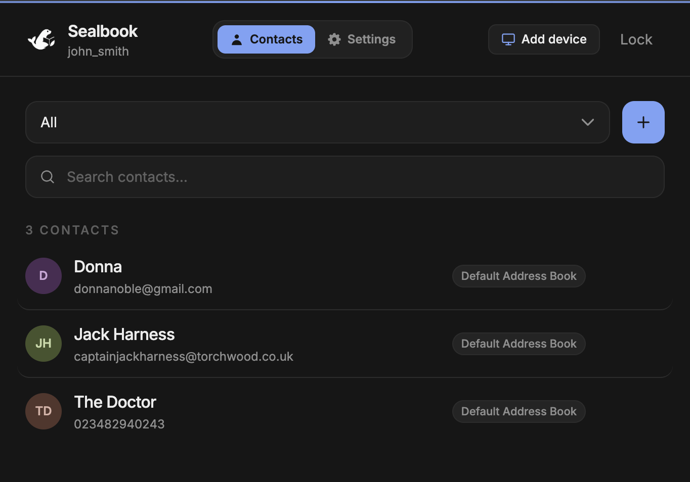

# Sealbook Web

Browser UI for the Sealbook vault.



> [!IMPORTANT]
This ia a web client only. A working [sealbook](https://github.com/silent-sphinx/sealbook) server is required for operation.

> [!NOTE]
> The server requires TLS 1.3 with the hybrid `X25519MLKEM768` key exchange, so
> the browser must support it: Chrome/Edge 131+, Firefox 132+, or Safari 26+.
> Older browsers cannot connect at all.

## Development

An existing [sealbook](https://github.com/silent-sphinx/sealbook) server is required for operation.

### 1. Clone sealbook-web

```
git clone https://github.com/silent-sphinx/sealbook-web.git
```

### 2. Generate the WASM package

The browser cryptography module is generated from the `sealbook` repository and
written to `src/pkg`. The repositories should be next to each other:

```text
sealbook/
sealbook-web/
```

From `sealbook-web`, install the Rust target and generate the package:

```bash
rustup target add wasm32-unknown-unknown
cargo install wasm-pack --locked
wasm-pack build ../sealbook/crates/sealbook-wasm \
  --target web \
  --release \
  --out-dir src/pkg
```

### 3. Install and run the NPM webserver

```bash
npm install
npm run wasm
npm run dev
```

Open `http://localhost:5173`. Vite proxies `/v1` to the local server (self-signed TLS is handled by the proxy).

## Docker

The final Docker image contains only the web client, but the build generates
the WASM package from the sibling `sealbook` repository. Build from the
directory containing both repositories:

```bash
cd ..
docker build -f sealbook-web/Dockerfile -t sealbook-web .
```

Run the web client:

```bash
docker compose up --build
```

Open `http://localhost:8080`.

The compose file publishes the port on the loopback interface only. The
container serves plain HTTP, and browsers withhold the cryptography Sealbook
needs from a plain-HTTP page anywhere but localhost, so to use it from other
machines put a TLS terminator in front that also sends
`Strict-Transport-Security`, and publish the container's port to that rather
than to the network.

Give the app an origin of its own, such as `sealbook.example.com`. Everything
served from one origin shares its local storage, IndexedDB and service-worker
scope, so another site or app on the same origin could read what this one
keeps in the browser.

The Docker Compose file also contains only the web client. Configure a
reachable Sealbook server in the web UI's connection settings.

